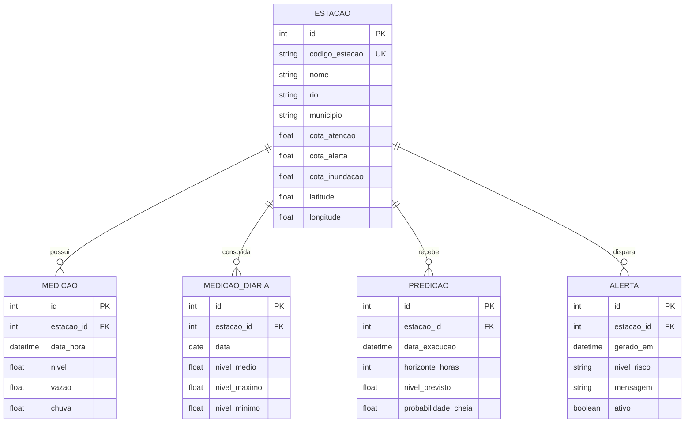
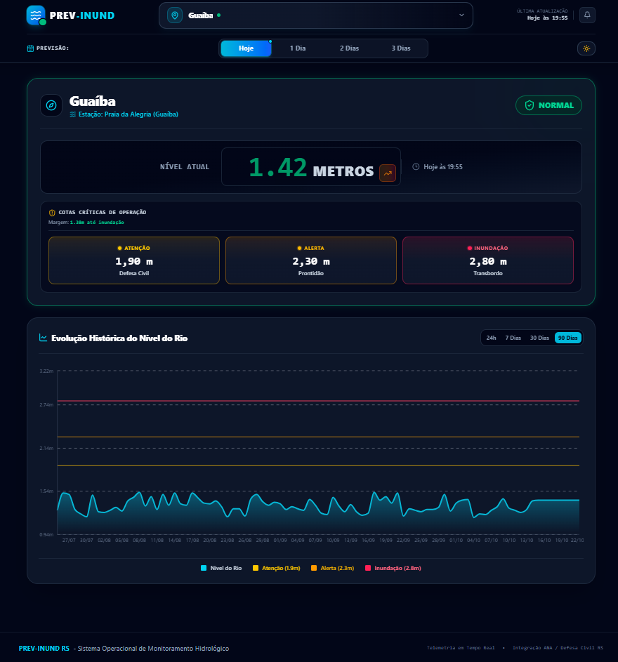
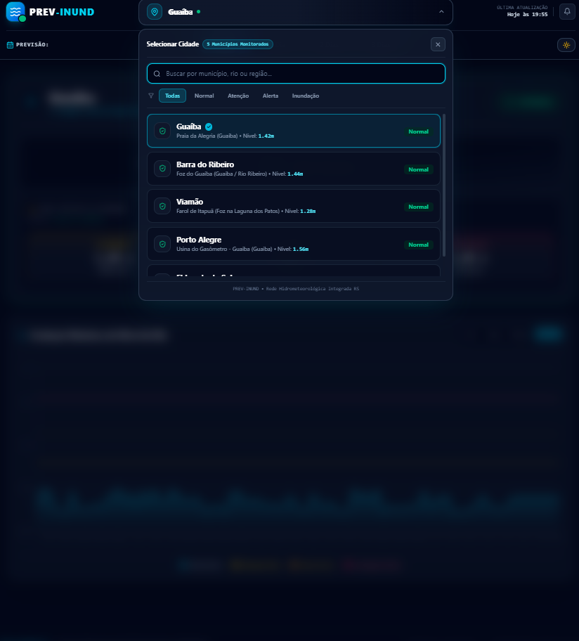
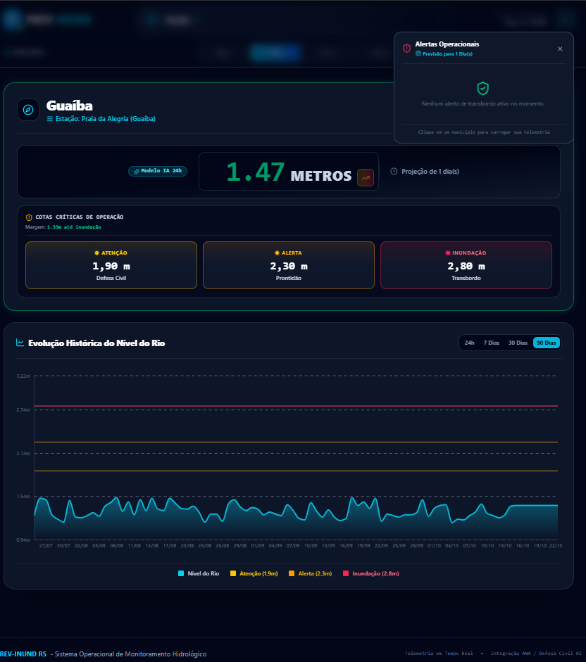

# PREV-INUND — Sistema Inteligente de Previsão e Mitigação de Cheias

Sistema preditivo e operacional de monitoramento hidrológico e emissão antecipada de alertas de inundação na Região Metropolitana de Porto Alegre e Bacia do Guaíba.

---

## 🏛️ Informações Institucionais

* **IES / Programa:** Residência em TIC 55 — Apoio à Recuperação do Rio Grande do Sul
* **Entidades Realizadoras / Parceiras:** MCTI (Ministério da Ciência, Tecnologia e Inovação), Softex, Instituto Brisa e Unisinos
* **Turma:** TIC 55 - Eldorado do Sul - Turma 2 - Grupo 1
* **Empresa Parceira / Cliente:** IPEMAI (*Instituto de Pesquisa de Meio Ambiente e Inovação*)
* **Representante do Cliente:** Dr. Paulo Rogério Foina
* **Membros do Grupo:**
  * Carlos Esteves
  * Evandro Santos
  * Matheus Cunha
  * Renata Nicolait
  * Thiago Caputi

---

## 🌊 Sobre o Projeto

O **PREV-INUND** integra uma malha de estações hidrometeorológicas distribuídas nos principais afluentes da bacia do Guaíba (rios Caí, Sinos, Taquari, Gravataí e Jacuí). O sistema realiza ingestão contínua de dados telemétricos de cotas, vazões e precipitações, executando modelos estatísticos e de aprendizado de máquina para prever eventos críticos com antecedência de **até 72 horas (3 dias)**.

### Principais Funcionalidades:
- **Monitoramento em Tempo Real:** Leitura telemétrica contínua com atualização automatizada via fontes oficiais (Defesa Civil do RS / ANA / INMET).
- **Modelos Preditivos de IA:** Predições hidrológicas para 24h, 48h e 72h baseadas em séries históricas e regressão supervisionada.
- **Simulador "What-If":** Ferramenta interativa de simulação de subida de cota e avaliação de impactos por cota de atenção, alerta e inundação.
- **Sistema de Alerta Antecipado (SAA):** Classificação automática do nível de risco (Normal, Atenção, Alerta e Inundação) e emissão de avisos operacionais.

---

## 🛠️ Tecnologias Utilizadas

A solução foi desenvolvida com arquitetura modular, escalável e desacoplada:

| Camada | Tecnologias |
|---|---|
| **Backend** | Python 3.10+, FastAPI, SQLModel, SQLAlchemy, Pydantic, APScheduler, Uvicorn |
| **Inteligência Artificial** | Scikit-Learn, Joblib, Pandas, NumPy |
| **Banco de Dados & Migrações** | PostgreSQL, Alembic |
| **Frontend** | Next.js 14+ (App Router), React, TypeScript, Tailwind CSS, Lucide Icons, Recharts |
| **DevOps & Infraestrutura** | Docker, Docker Compose, Git / GitHub, Vercel |
| **Testes & Qualidade** | Pytest, Vitest, Playwright, ESLint |

---

## 🗄️ Modelo de Dados

O banco de dados armazena o histórico telemétrico, métricas consolidadas diárias, previsões de IA e eventos de alerta:



---

## 🌱 Banco de Dados e Dados de Teste (Seed)

O sistema conta com rotina automatizada e script de seed idempotente para popular o banco com as 5 estações oficiais de monitoramento do Lago Guaíba e Foz da Laguna dos Patos, além de medições e previsões realistas de teste:

```bash
# Executar o seed a partir do diretório backend
python -m app.seed
```

---

## 💻 Protótipos Finais e Telas do Sistema

A aplicação está disponível e implantada em produção para acesso imediato da banca e usuários:
👉 **[previnund.vercel.app](https://previnund.vercel.app)**  

### 📸 Telas da Aplicação

| Painel Principal (Dashboard) | Seleção de Estações (Dropdown) |
|:---:|:---:|
|  |  |

<br/>

**Central de Alertas e Notificações:**


---

## 🚀 Roteiro de Instalação e Execução para o Cliente

Siga os passos abaixo para executar a aplicação completa em ambiente local:

### 1. Clonar os Repositórios
```bash
# Backend
git clone https://github.com/Prev-Inund/backend.git

# Frontend
git clone https://github.com/Prev-Inund/frontend.git
```

### 2. Inicializar o Banco de Dados (Docker)
```bash
cd backend
docker compose up -d
```

### 3. Configurar e Executar o Backend
```bash
# Crie e ative o ambiente virtual
python -m venv venv
.\venv\Scripts\Activate.ps1    # No Windows PowerShell
# source venv/bin/activate     # No Linux / macOS

# Instale as dependências
pip install -r requirements.txt

# Configure o arquivo de ambiente
cp .env.example .env

# Aplique as migrações do banco
alembic upgrade head

# Popule o banco com os dados de teste
python -m app.seed

# Inicie o servidor da API
uvicorn app.main:app --reload --port 8000
```
> A API estará acessível em: `http://localhost:8000` (Docs: `http://localhost:8000/docs`).

### 4. Configurar e Executar o Frontend
Em outro terminal:
```bash
cd frontend
npm install
npm run dev
```
> A interface web estará acessível em: `http://localhost:3000`.

---

## 📑 Apresentação Final para a Banca

A apresentação oficial do projeto para avaliação da banca avaliadora está disponível para visualização e download:
* 📄 **[Visualizar Apresentação Final da Banca (PDF)](https://github.com/Prev-Inund/.github/blob/main/APRESENTA%C3%87%C3%83O_FINAL_GRUPO1_PREVINUND.pdf)**
* 📥 **[Download Direto do Arquivo PDF](https://raw.githubusercontent.com/Prev-Inund/.github/main/APRESENTA%C3%87%C3%83O_FINAL_GRUPO1_PREVINUND.pdf)**
